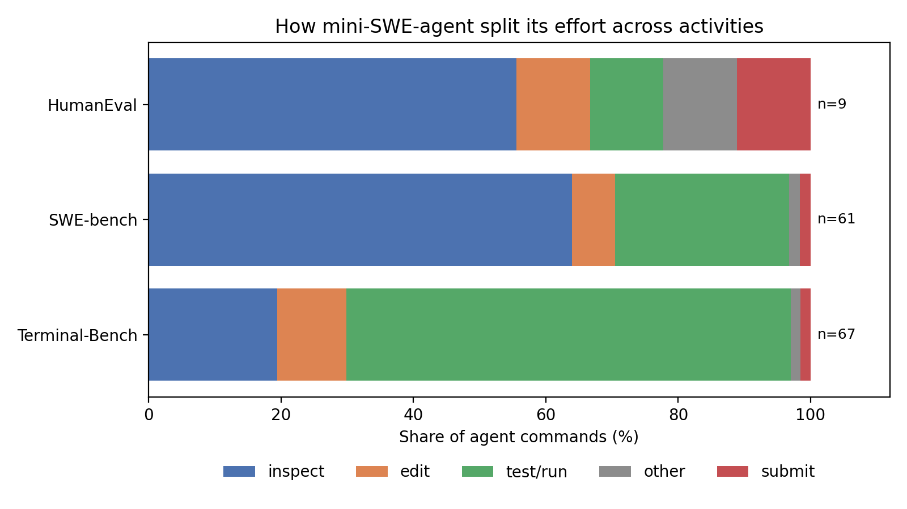
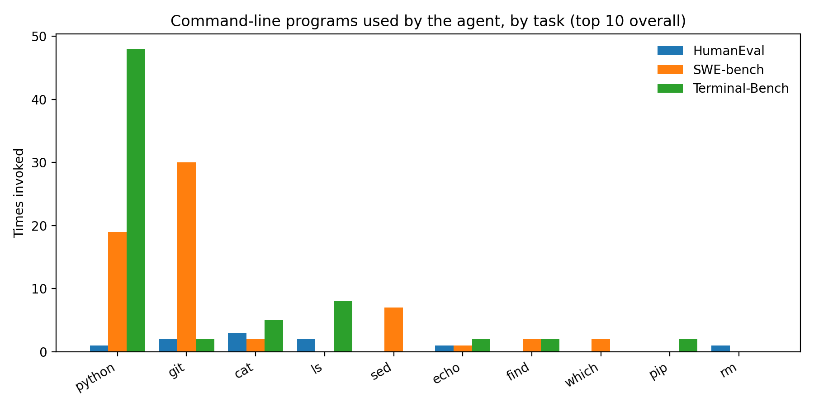
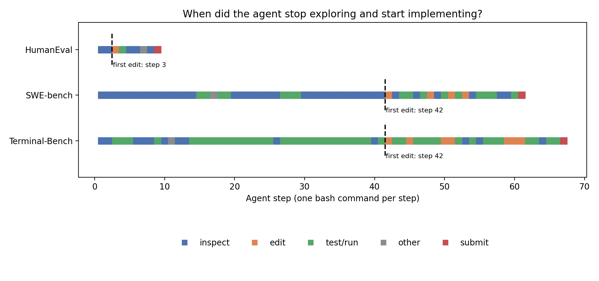

# Section 3: Run Example Tasks

## 3.1 Task 1: HumanEval

**Problem 3 (`run-example-task`)**

1. Which files are available to the agent while it works, and which files become available only during verification? Why does this separation matter?

   The agent only gets two things while it works: the prompt from `instruction.md` and the file `/app/humaneval_0.py`. I checked the Dockerfile and it only copies that one file into `/app`. The `tests/` folder (`test.sh` and `test_outputs.py`) shows up in `/tests` after the agent is done, and `solution/solve.sh` is only used when the agent is the oracle. This matters because if the agent could read the tests, it could just hardcode the seven expected outputs, or copy the solution, and still get full reward. Keeping them hidden is what makes a reward of 1 actually mean "the function is correct."

2. Run `uv run harbor run --help`. Name two agent scaffolds other than `oracle` and two environment backends other than Docker. What distinct role does each category play?

   Two other agent scaffolds are `claude-code` and `openhands`, and two other environment backends are `daytona` and `modal`. The scaffold is the code wrapped around the model. It gives the model the task, turns the model's replies into actions like bash commands, and keeps looping until the model says it is done. The backend is where those actions actually run, either in a Docker container on my laptop or in a sandbox in the cloud. Since they are separate, I can compare two agents on the same environment, or move the same run to the cloud, without touching the task itself.

3. Trace the verification process after the agent finishes: which file does Harbor execute, where do the private tests come from, and how is the final reward communicated back to Harbor?

   When the agent finishes, Harbor copies the task's `tests/` folder into the container at `/tests` and runs `/tests/test.sh`. The private tests are in `tasks/humaneval-0/tests/test_outputs.py`. That script imports `has_close_elements` from `/app/humaneval_0.py`, the file the agent edited, and runs seven `assert` checks on it. `test.sh` doesn't return the score directly. If the Python script passes it writes `1` to `/logs/verifier/reward.txt`, and if anything fails it writes `0`. Harbor reads that file afterwards and saves the number as the reward in `result.json`.

**Problem 4 (`run-example-agent`)**

1. Summarize the agent's approach. Which files and commands did it use?

   The run was short, 9 steps in under two minutes. Gemini started by reading `/app/humaneval_0.py` with `cat` (step 3) and running `ls` on `/app` to see if there was anything else (step 4). In step 5 it overwrote the whole file with a `cat <<'EOF'` heredoc. Instead of checking every pair, it sorts the list and only compares numbers that end up next to each other. In step 6 it wrote a quick `python3 -c` test that ran the doctests, seven asserts, and some edge cases, and all of them passed. Then it tried `git status`, which failed because `/app` isn't a git repo, cleaned up `__pycache__`, printed the file one last time, and submitted.

2. Identify one decision in the trajectory that helped or hurt the final result. Cite the relevant step.

   The most helpful decision was testing its own code before submitting (step 6). It didn't just rerun the two docstring examples. It also tried an empty list, a single number, and `[1.0, 1.0]` with threshold `0.0`, which checks that "closer than" means strictly less than. What surprised me is that its seven asserts are exactly the same as the hidden ones in `test_outputs.py`, even though it never saw that file. My guess is that it remembered the official HumanEval tests from training. The only wasted move was `git status` in step 7, which failed since there is no git repo.

3. Did the verifier reward accurately reflect the quality of the agent's solution? Why or why not?

   For this run I think the reward of 1 is fair. The code is correct, because once the list is sorted the two closest numbers have to be neighbors, so checking neighbors is enough. It is also faster than the oracle's double loop (O(n log n) vs O(n²)), and the verifier still accepted it, which is good since it shouldn't only accept the reference approach. But I don't think it says much about how good the model is at coding in general. There are only seven tests, and the model wrote those exact tests from memory, so HumanEval is probably in its training data. A 1 here tells me this function works, not that the model would handle a problem it hasn't seen.

## 3.2 Task 2: SWE-bench Verified

**Problem 5 (`run-swebench-agent`)**

1. Summarize the agent's approach. How did it locate the relevant code, and what change did it make?

   This run took 61 commands and about 12 minutes. The issue mentions `contrib.auth.validators`, so the agent ran `find . -name "validators.py" | grep auth` (command 1) and then read `django/contrib/auth/validators.py` (command 2). After that it spent a long time digging through the repo with `git grep`, `git log -S`, and `git show`, mostly checking how Django already uses `\A` and `\Z` and how these validators changed over time. It also had to figure out which Python to use (`which python`, `conda env list`, commands 16–17) before Django's test runner would work. The actual fix came at command 42. It replaced `r'^[\w.@+-]+$'` with `r'\A[\w.@+-]+\Z'` in both `ASCIIUsernameValidator` and `UnicodeUsernameValidator`. After that it added usernames with a trailing newline to the existing tests (commands 48–53) and ran `tests/runtests.py auth_tests` until everything passed.

2. Identify one point where the agent used repository context that would not exist in a self-contained HumanEval task.

   The clearest example is the git history. In commands 20–23 and 30–38 it ran things like `git log -S "\A"`, `git log --grep="UsernameValidator"`, and `git show <commit>` to look at older commits that touched these validators and to see that other Django validators already use `\A...\Z`. That told it the fix matched how the project already does things. It also opened the existing test file `tests/auth_tests/test_validators.py` and added its new cases in the same format. None of this is possible in HumanEval, where the only thing in the container is one file with an empty function.

3. Compare this trajectory with the HumanEval trajectory. What made this task more difficult to understand, modify, or verify?

   The numbers show the difference. HumanEval took 9 commands and the agent was editing by command 3. Here it took 61 commands and the first edit was at command 42, so about two thirds of the run was just exploring. Understanding was harder because the right file is buried in a huge codebase and the bug is a Python regex detail (`$` also matches before a trailing newline) instead of a clearly described function. Verifying was harder too. It had to find the conda environment and Django's own test runner, and it had to make sure the change didn't break other tests. The fix itself was only two lines, so the hard part was finding and checking, not writing code.

4. Did the final reward accurately reflect the quality of the agent's solution? Support your answer with evidence from the verifier logs.

   Yes. In `report.json` the verifier lists `"patch_successfully_applied": true` and `"resolved": true`. The three FAIL_TO_PASS tests (`test_ascii_validator`, `test_unicode_validator`, `test_help_text`) pass now, which shows the bug is fixed, and all the PASS_TO_PASS tests still pass, which shows nothing else broke. The diff is the same change the issue asked for, applied to both validators, so I think a 1 is deserved. One thing worth noting is that the issue already spelled out the regex to use, so this task was really testing whether the agent could find the right place and confirm the fix, not whether it could come up with it.

## 3.3 Task 3: Terminal-Bench 2.1

**Problem 6 (`run-terminal-bench-agent`)**

1. Summarize the agent's approach. What information did it gather, and what solution strategy did it pursue?

   This was the longest run, 67 commands over about 19 minutes. It began by reading `/app/forward.py` (command 2), checking which Python packages were installed, and printing the weight shapes (command 9). Its plan was the usual way to steal a ReLU network. It picks random lines through the input space and calls `forward()` along them. It looks for the "kinks" where some hidden neuron turns on or off, and compares the gradient on each side of a kink. The difference gives one row of `A1` up to a scale factor (commands 14–32). Then it tried the method on fake networks it generated itself with different sizes (commands 33–34 and 45–59), put the method into `/app/steal.py` (commands 42 and 61), and checked `stolen_A1.npy` against the `A1` in the local file.

2. Identify one point where the agent made meaningful progress and one point where its approach broke down or became unproductive.

   The real progress was around commands 31–33. That's where the kink method started giving correct rows of `A1`, and the agent started testing on its own fake networks with different numbers of neurons, which is a good way to see if the method works beyond one example. Things went downhill in the second half. It kept overwriting `/app/forward.py` to swap in test networks (commands 45–59), then had to put the original back (command 60), and it spent a lot of steps chasing one bad neuron it called "Stolen 15" (command 58). I think the bigger problem is that it kept checking itself against the real `A1` sitting in `forward.py`. That made it look like it was working on the local 20-neuron network, but it never really prepared for a different, bigger network.

3. What evidence does the verifier provide beyond the scalar reward? Does it capture partial progress on this task?

   The reward itself is just 0, but `test-stdout.txt` has a lot more. The test file first swaps `forward.py` for a different network with 30 neurons (seed 5), apparently to stop agents from just reading the weights, then runs `steal.py`. It reports `Failed to match rows: [5, 14, 19, 26, 27, 28, 29]`. So 7 rows were wrong and 23 out of 30 were right, which is honestly pretty close. The 0/1 reward hides that completely, since getting 23 rows right scores the same as getting none. You only see how close it was by reading the log.

4. How did the open-ended terminal environment affect the agent's ability to plan, test its assumptions, and recover from mistakes?

   Being able to do anything in the terminal helped it test ideas. It could run quick Python experiments, make fake networks, and see how well the method worked before committing to a final script. That's where most of its effort went, since it called `python` 48 times. But all that freedom made it worse at planning. There was no point where it had to stop and commit, so it ran experiments for over 40 commands before writing `steal.py`, and it edited `forward.py`, which it shouldn't have touched. It was able to undo mistakes because it could look at and restore files. What it couldn't fix was not knowing that grading uses a different, larger network, so passing its own checks made it more confident than it should have been.

## 3.4 Analyzing Agent Trajectories

**Problem 7 (`analyze-trajectories`)**

### `effort-distribution.png`

How did the agent distribute its effort across activities such as inspecting files, editing code, running tests, and debugging?

I put every bash command into one bucket: inspect (reading or searching, like `cat`, `ls`, `grep`, `git log`), edit (changing a file, like `sed -i`, a heredoc, or Python that writes a file), test/run (running Python, a test suite, or a script), submit, or other. Then I plotted what percent of each run fell in each bucket. HumanEval (9 commands) and SWE-bench (61) were mostly inspecting, at 56% and 64%, while Terminal-Bench (67) was mostly running code, at 67%, because there the agent learned about the network by experimenting instead of reading code. Editing was small in all three (7–11%), so most of the agent's time goes into understanding and checking rather than writing.

### `bash-command-usage.png`

`mini-SWE-agent` performs its work through `execute_bash`. What command-line programs and command patterns did it use across the three trajectories, and how did their use vary by task?

For each command I pulled out every program it calls (splitting on `&&`, `|`, `;`, and new lines, and ignoring code inside quotes or heredocs), counted `python` and `python3` as the same thing, and plotted the 10 most common programs. Each task has its own favorite tool. SWE-bench used `git` 30 times, mostly `git grep`, `git log`, and `git show` to search the code and its history. Terminal-Bench used `python` 48 times for experiments, and HumanEval barely needed more than `cat` and `ls`. So the agent picks tools that fit the setting, version control for a real repo and Python for a math-heavy open-ended problem.

### `exploration-to-implementation.png`

At what points did each agent appear to transition from exploring the task to implementing a solution? Define how your visualization identifies that transition.

Each square is one command, colored with the same buckets as the first figure, and I count the switch from exploring to implementing as the first command that edits a file (the dashed line). HumanEval switched at command 3 of 9 (22% of the way in), but SWE-bench and Terminal-Bench didn't switch until command 42 (67% and 61% of the way in). The harder tasks made the agent explore much longer before it was ready to commit. In Terminal-Bench the colors keep flipping between edit and test after the line, which shows it kept revising instead of getting it right the first time.
